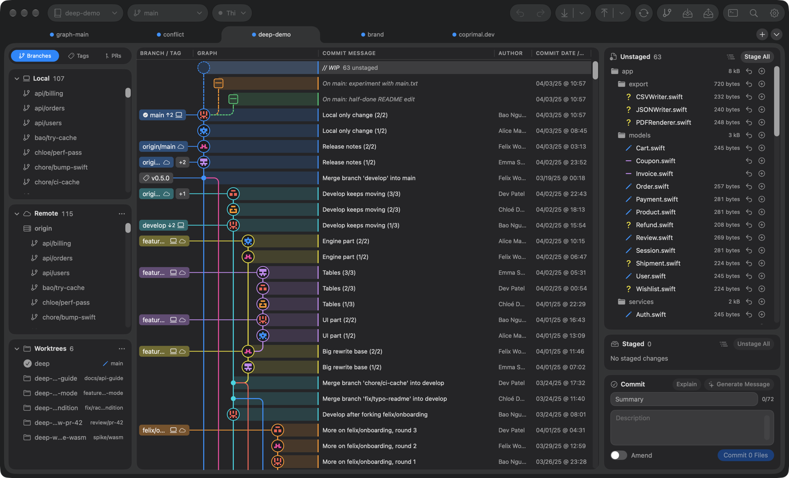

<div align="center">


# Histq

**A native macOS git client that drives the git you already have.**

[](https://github.com/dinhanhthi/Histq/releases/latest)
[](LICENSE)


[Website](https://histq.coprimal.dev) · [Docs](https://histq.coprimal.dev/docs.html) · [Download](https://github.com/dinhanhthi/Histq/releases/latest) · [Changelog](CHANGELOG.md)



</div>

Histq is written in SwiftUI and AppKit. It runs the `git` on your Mac, so your repositories, config, SSH keys and hooks
work as they are.

- Fast commit graph with search
- Stage files, hunks or lines; a line-by-line conflict editor
- Interactive rebase, and undo/redo for local operations
- Worktrees, tabs and a command palette (Cmd-K)
- Per-tab profiles: identity, commit signing, SSH key, GitHub account
- GitHub pull requests and issues
- Optional AI help with your own provider key
- A terminal drawer per tab

More in the [docs](https://histq.coprimal.dev/docs.html).

## Install

Download the `.dmg` from [Releases](https://github.com/dinhanhthi/Histq/releases/latest) and drag Histq to
`/Applications`. It updates itself with [Sparkle](https://sparkle-project.org).

Needs macOS 15 or later on Apple silicon, and git 2.36 or later (the Command Line Tools git or Homebrew's).

## Privacy

No account, no analytics, no telemetry. Histq goes online only for your git remotes, GitHub once you connect an
account, an AI provider when you click an AI button, real avatars if you turn them on, and update checks. Details on
the [privacy page](https://histq.coprimal.dev/privacy.html).

## Development

```sh
brew install xcodegen
xcodegen generate
xcodebuild -project Histq.xcodeproj -scheme Histq -configuration Debug -skipPackagePluginValidation build
```

See [CONTRIBUTING.md](CONTRIBUTING.md).

## License

© 2026 Anh-Thi Dinh. [GPL-3.0](LICENSE).
